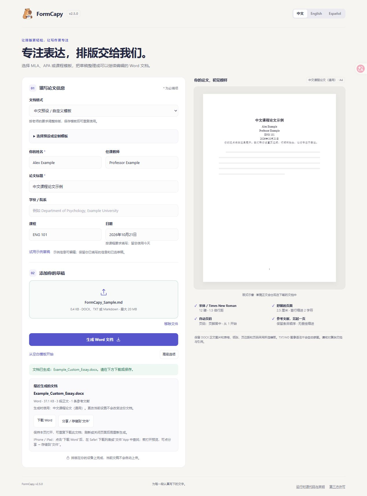
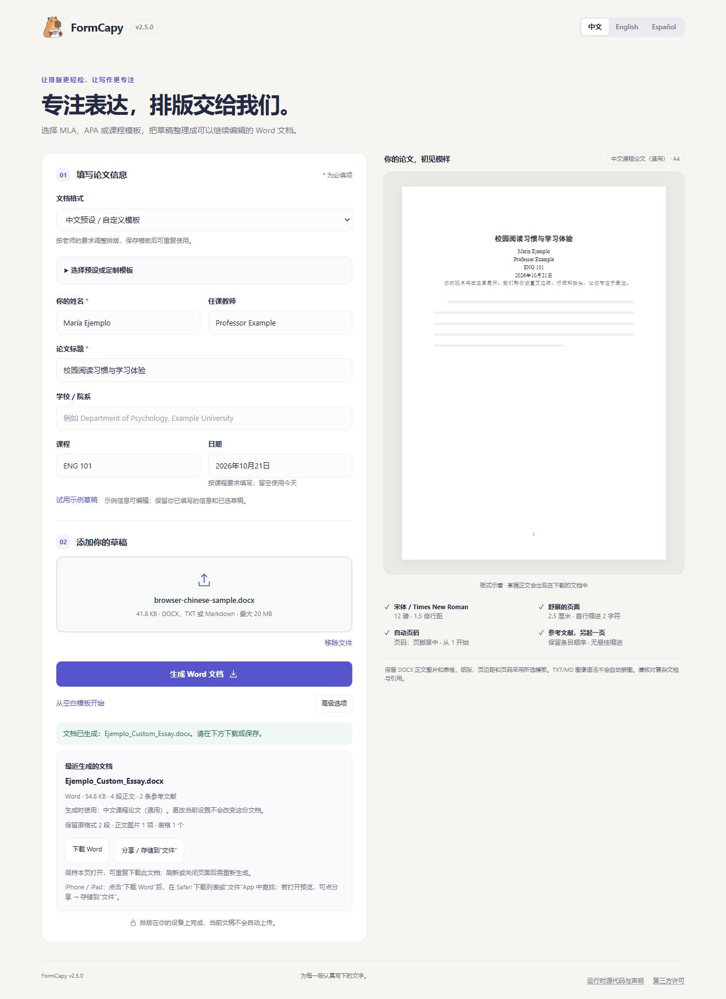
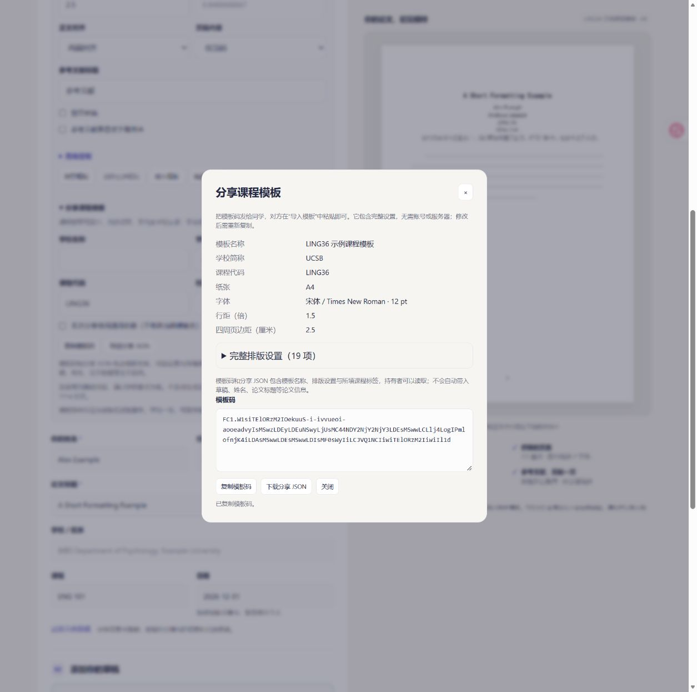
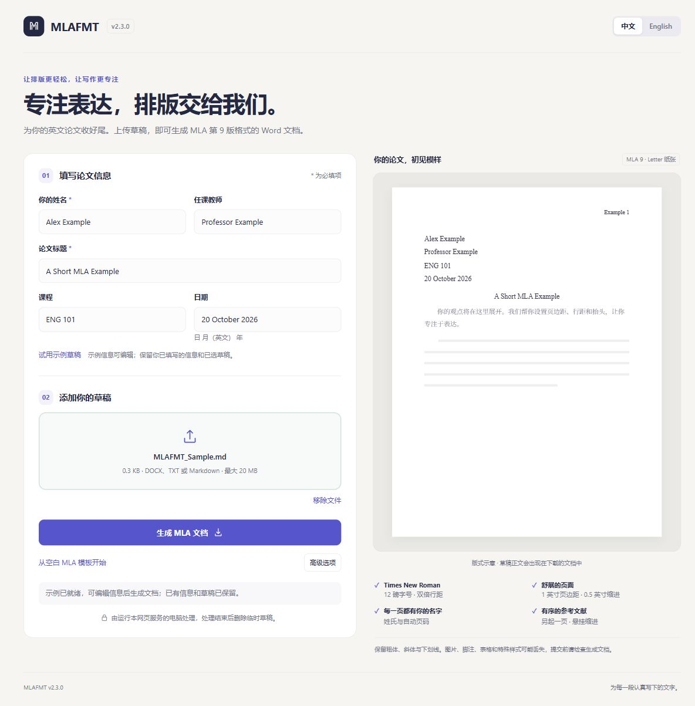
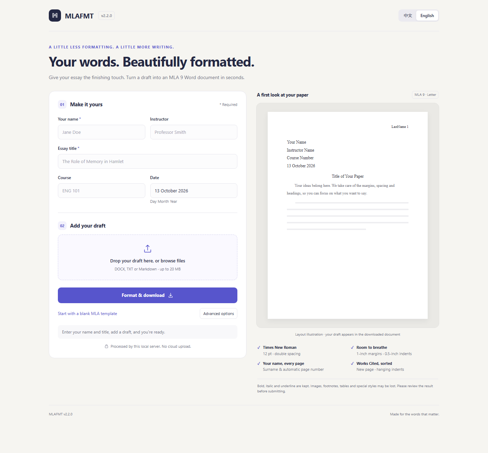

# FormCapy · 论文与报告排版


[立即使用网页版 / Use in browser](https://formcapy.com/) · [中文](#中文) · [English](#english) · [版式 / Formats](docs/FORMATS.md) · [下载 / Downloads](https://github.com/SuperOoze0309/MLAFMT/releases/latest)

**免费使用，无需注册。排版在你的设备上完成，当前文稿不会自动上传。** 支持 `.docx`、`.txt`、`.md`，可整理为 MLA 9、APA 7 学生论文或自定义课程模板。

**Free, no account required. Formatting runs on your device; the current draft is not uploaded automatically.** Format DOCX, TXT or Markdown as MLA 9, APA 7 student papers or a custom course template.

**v2.6.0 静态网页版已上线，新增课程模板码与分享 JSON；离线下载仍为 v2.5.0，不包含这两项功能。** **The static website now runs v2.6.0**, with template codes and sharing JSON; offline downloads remain v2.5.0 without these features. [网页版发布说明 / Web release notes](https://github.com/SuperOoze0309/MLAFMT/releases/tag/v2.6.0) · [部署状态 / Deployment status](docs/DEPLOYMENT.md)

## 三步开始 / Get started

1. 打开 [formcapy.com](https://formcapy.com/)，选择格式并填写论文信息。Open the site, choose a format and enter your paper details.
2. 选入草稿；DOCX 可选多段保留原格式。Choose a draft; optionally keep selected DOCX paragraphs unchanged.
3. 点 **生成 Word 文档 → 下载 Word**。Select **Format document → Download Word**.



*历史 v2.5.0 正式网站截图，使用虚构信息和内置 Markdown 示例；当前网站为 v2.6.0。右侧为版式示意。Historical v2.5.0 live-site screenshot using fictional details and the built-in Markdown demo; the current website runs v2.6.0.*

首次使用需要联网下载程序。iPhone/iPad 的保存步骤见 [Apple 指南 / Apple guide](docs/APPLE.md)；Safari 与 Apple 实机流程尚未验证。First use needs an internet connection; Safari and Apple device workflows remain unverified.

若仍显示旧版，先下载当前文稿，再关闭本站旧标签页并重新打开。If an old version remains open, download your current document before closing the site's old tabs and reopening.

应用名为 **FormCapy**，GitHub 项目保持 **MLAFMT**。App: FormCapy; repository: MLAFMT.

## 下载 / Downloads

**[FormCapy v2.5.0 已发布 / Released](https://github.com/SuperOoze0309/MLAFMT/releases/tag/v2.5.0)** · 2026-10-21

本轮 v2.6.0 面向静态网页版，不发布新的桌面或 Android 安装包；以下 v2.5.0 下载不含模板码／分享 JSON，仍可用兼容裸 JSON 交换排版设置。This v2.6.0 update targets the static website. The v2.5.0 packages below do not support template codes or sharing JSON; compatible bare layout JSON remains available.

| 设备 / Device | v2.5.0 下载 / Download | 安装 / Install |
| --- | --- | --- |
| Windows 10/11 · x64 | [Windows 应用](https://github.com/SuperOoze0309/MLAFMT/releases/download/v2.5.0/MLAFMT.exe) | 双击运行 / Open the EXE |
| macOS 14+ · M 系列 / Apple silicon | [Mac DMG](https://github.com/SuperOoze0309/MLAFMT/releases/download/v2.5.0/MLAFMT-v2.5.0-macos-arm64.dmg) | 拖入应用程序 / Drag to Applications |
| macOS 14+ · Intel | [Mac DMG](https://github.com/SuperOoze0309/MLAFMT/releases/download/v2.5.0/MLAFMT-v2.5.0-macos-x64.dmg) | 拖入应用程序 / Drag to Applications |
| Linux · x64 · Ubuntu 22.04+ 或兼容系统 / or compatible | [Linux AppImage](https://github.com/SuperOoze0309/MLAFMT/releases/download/v2.5.0/MLAFMT-v2.5.0-linux-x64.AppImage) | 允许执行后运行 / Mark executable and open |
| Android 7+ · 64 位 / 64-bit | [Android APK](https://github.com/SuperOoze0309/MLAFMT/releases/download/v2.5.0/MLAFMT-v2.5.0-android.apk) | 下载后安装 / Download and install |

macOS 包目前未经过 Apple 公证。首次打开若被系统阻止，可在“系统设置 → 隐私与安全”确认打开。macOS builds are not Apple-notarized; if blocked on first launch, confirm the app in System Settings → Privacy & Security.

桌面和 Android 在设备上离线处理，无需安装 Python。Desktop and Android work offline without installing Python. iPhone/iPad 使用网页版，没有原生 iOS App。Use the website on iPhone/iPad; no native iOS app is available.

<details>
<summary>其他下载 / Other downloads</summary>

- [Windows ZIP（包含图文说明）/ Windows ZIP with illustrated guide](https://github.com/SuperOoze0309/MLAFMT/releases/download/v2.5.0/MLAFMT-v2.5.0-windows-x64.zip)
- [Linux tar.gz（无 FUSE 时使用）/ Linux tar.gz for systems without FUSE](https://github.com/SuperOoze0309/MLAFMT/releases/download/v2.5.0/MLAFMT-v2.5.0-linux-x64.tar.gz)
- [SHA-256 校验和 / Checksums](https://github.com/SuperOoze0309/MLAFMT/releases/download/v2.5.0/SHA256SUMS.txt)

</details>

## 功能 / Features

v2.5.0 提供三种选择：**MLA 9 / APA 7 学生论文 / 自定义课程模板**。

- **APA 7 学生论文**：选择格式后填写学校/院系、课程、教师和截止日期；自动生成独立标题页、正文标题、页码和新页 References。保留 DOCX Heading 1–3 和 Markdown `#`–`###` 的标题层级；标题大小写保持原文，请按课程要求核对。
- **自定义课程模板**：选择该格式，打开模板设置，调整老师要求的纸张、字体、行距和页边距，再保存为命名模板；下次直接选择使用。桌面和网页可导入/导出 JSON 文件，Android 可复制/粘贴同一份 JSON。
- **高级定制**：模板设置的二级入口可调整页码位置（右上、页脚居中或页脚右侧）、起始数字（1–9999）和封面是否显示页码。默认右上、从 1 开始、封面显示；隐藏封面页码时，正文第一页从所设数字开始。
- **指定段落保持原格式**：读取 DOCX 后可多段勾选、全选、清空，或输入 `2, 4-6` 等编号范围；保留所选段落的字体、字号和段落格式。选择仅用于当前草稿，不进入课程模板；换稿清空，检测到源文件变更时需重新读取段落。
- **正文对象保留**：从源 DOCX 包保留正文图片和表格；表格整体保留，不逐段勾选。纸张、页边距、页码及源分节、页眉和页脚按所选模板重建，原分页位置可能改变。TXT/MD 图片语法不会嵌入图片。
- **课程报告示例**：[A4 模板](examples/course-report-a4.json) 使用 Arial 11 pt、1.5 倍行距和 2.5 cm 页边距；页码在页脚居中，封面不编号，正文从 1 开始。可导入后修改；它是示例，不代表任何学校规范。

三种格式共用同一排版核心，Tk 桌面、本地 Flask 网页、浏览器本地静态版和离线 Android 使用同一套规则。Android 已通过 CI 编译与模拟器验证，实机尚未验证。参考文献内容保持原文，版式和完整字段说明见[格式指南](docs/FORMATS.md)。

APA 官方参考：[Paper format](https://apastyle.apa.org/style-grammar-guidelines/paper-format) · [Title page](https://apastyle.apa.org/style-grammar-guidelines/paper-format/title-page)。

### v2.5.0 新增：中文预设与西班牙语 / Added in v2.5.0

v2.5.0 新增 **中文课程论文（通用）** 和 **中文毕业论文（基础版）**，放在 **中文预设 / 自定义模板** 的内置预设中：A4、宋体小四、首行缩进 2 字符、两端对齐和页脚居中页码；毕业论文基础版使用固定 20 pt 行距和不编号的基础封面。可选中后继续修改并保存为自己的模板。

预设不生成目录、摘要或学校专用封面，不自动转换 GB/T 7714 引用格式；学校要求优先。网页版、v2.5.0 源码及上方下载均可使用。详情与可导入 JSON 见[格式指南](docs/FORMATS.md)。

1. 选择 **中文预设 / 自定义模板**。
2. 展开 **选择预设或定制模板**，选择课程论文或毕业论文基础版；需要时进入 **高级定制** 调整字体、缩进和行距。
3. 填写论文信息、选择草稿，再生成并保存 Word；查看结果中的保留数量，并对照原稿核对图片、表格和引用。



*v2.5静态本地预览，虚构测试信息。Local static preview with fictional test details; this is not a public-site screenshot.*

v2.5.0 includes two editable built-in Chinese presets for course papers and basic theses, with separate Chinese/Latin fonts, character indentation and exact point spacing. Choose **Chinese presets / Custom template**, select a built-in preset, adjust it if needed, and generate Word. These presets are available on the public website and in the v2.5.0 source and packages above. See the [format guide](docs/FORMATS.md) for settings and scope.

v2.5.0 还加入 **Español** 界面，覆盖静态网页构建、桌面和 Android；切换语言不会翻译文稿或个人模板名。

v2.5.0 also includes Spanish in the static web build, desktop and Android interfaces. Changing the interface language does not translate drafts or personal template names.

### v2.6.0 网页版新增：课程模板分享 / New on the website: course-template sharing

**v2.6.0 静态网页版已上线，以下功能可在 [formcapy.com](https://formcapy.com/) 使用；离线安装包仍为 v2.5.0。** 展开 **分享课程模板**，复制以 `FC1.` 开头的模板码发给同学；接收者在 **导入模板** 中粘贴，点击 **预览模板**，核对后再点 **应用此模板**。也可导出带版本的 **分享 JSON**；现有仅含排版设置的兼容 JSON 导入/导出继续保留。



*v2.6.0 正式网站的 Edge 截图；UCSB／LING36 仅为用户自填的课程标签示例，不代表学校官方模板或课程认证。Live v2.6.0 website in Edge; UCSB/LING36 are user-entered example labels, without institutional verification.*

- 学校全名、学校简称、课程代码、校区／学期可分别填写，不根据 `UCSBLING36` 等代码猜学校，也不声明课程标签唯一或官方认证。
- 分享内容包含模板名称、排版设置及主动填写的课程标签；不会自动带入文稿、姓名、论文标题、教师、段落保留选择或生成结果。可选 **本次分享使用通用名称**，不修改当前模板名；持有码或文件的人可以读取其中的名称和标签。
- 模板码完整自带设置，不使用链接、服务器、账号或后台查码。设置修改后需重新复制；旧码不会更新或撤销。保存到 **我的模板** 仅保存排版设置，课程标签需用模板码或分享 JSON 留存。

**These features are live on the v2.6.0 static website; offline packages remain v2.5.0.** Expand **Share a course template** and copy an `FC1.` template code. Recipients paste it into **Import template**, preview and explicitly apply it. Codes and sharing JSON carry all settings and optional school/course labels; layout-only JSON remains compatible with existing apps. Drafts and paper details are not added automatically. Anyone with a copy can read the template name and labels. No link, server, account or code-lookup service is involved. Saved templates retain layout only; keep a code or sharing JSON to retain labels.

操作及两种 JSON 的区别见[格式指南](docs/FORMATS.md#课程模板分享)。完整协议见[分享设计](docs/SHARING-DESIGN.md)。参考文献结构化编辑和 MLA/APA/GB/T 条目转换仍仅为设计，未实现。

## 中文

### 网页版与隐私

网页版通过可信 HTTPS 开放访问，不需要账号或旁边有电脑。草稿和论文信息在浏览器本地处理；切换界面语言不会翻译或改写文稿。首次下载程序后，离线使用还取决于缓存完成和浏览器是否保留缓存。

程序、缓存及依赖材料说明见[浏览器本地构建指南](docs/BROWSER-LOCAL.md)，部署与已验证范围见[上线记录](docs/DEPLOYMENT.md)。Safari、macOS、iPhone、iPad、Firefox 及 Android 实机尚未验证。

### 桌面快速开始

以下步骤适用于 v2.5.0 安装包；可选择 MLA、APA 或自定义模板。

1. 下载与你的系统对应的文件，按上表安装并打开。
2. 选择格式并填写姓名、论文标题及相应信息；MLA 的老师和课程可选，日期留空会使用今天。
3. 拖入草稿，或点击选择文件，然后转换并保存 `.docx`。

#### 图示：填写信息并生成文档



*图为 v2.3.0 本机网页端示例；桌面端使用相同的论文信息和转换步骤。*

1. 填写姓名和标题；老师、课程可选，并确认日期。
2. 拖入 `.docx`、`.txt` 或 `.md` 草稿，也可以点击上传区域选择文件。
3. 点击 **生成 MLA 文档**，然后在结果卡中点 **下载 Word**；页面保持打开时可再次下载。右侧页面是版式示意，下载的 Word 文档中会包含草稿正文。

顶部的 **中文 / English** 可随时切换界面语言，并记住你的选择。高级选项包含页眉姓氏、段落拆分、标题识别和块引用设置，也可直接创建空白 MLA 模板。

macOS 支持 ⌘O 选择文件、⌘Return 转换；Windows/Linux 使用 Ctrl。桌面与 Android 版均在设备上处理文档，转换时无需联网。

Mac 也可以在 Finder 中选择“打开方式 → FormCapy”，或把草稿拖到 Dock 图标。保存后点 **在 Finder 中显示** 可选中生成文件。

### Android 快速开始

以下步骤对应 v2.5.0 APK。

1. 安装 APK 后，填写姓名和论文标题。
2. 点击选择草稿，通过系统文件选择器选入 `.docx`、`.txt` 或 `.md`。
3. 生成后选择保存位置；也可以直接打开或分享给 Word、WPS 等应用。

Android 版不需要账号或广泛的存储权限，仅访问你选择的文件；支持 64 位 ARM 手机和平板，以及 x86_64 模拟器。

支持折叠屏展开、合拢、半折叠与分屏窗口；界面避让折痕，并保留已填信息、草稿和转换结果。

### MLA 9 自动整理的内容

| 项目 | 输出格式 |
| --- | --- |
| 页面 | Letter 纸张（8.5 × 11 英寸）、1 英寸页边距 |
| 字体与行距 | Times New Roman 12 pt、双倍行距、段前段后 0 pt |
| 首页 | 姓名 / 老师 / 课程 / 日期、居中标题 |
| 页眉 | 右对齐的姓氏与自动页码；支持手动指定姓氏 |
| 正文 | 左对齐、首行缩进 0.5 英寸；保留 Word 草稿中的粗体、斜体、下划线 |
| Works Cited | 另起一页、标题居中、按字母排序、0.5 英寸悬挂缩进 |

在草稿正文后单独写一行 `Works Cited`，下面每段放一条文献。纯文本可用 `*Hamlet*` 表示斜体。草稿已有的姓名和标题可自动去重，高级选项可关闭此功能。MLA 默认日期使用英文日月年格式；手动填写的日期文字保持原样。

### APA 7 学生版式与自定义模板

APA 7 学生版式、自定义课程模板及其字段、边界、JSON 示例见 [docs/FORMATS.md](docs/FORMATS.md)。

在模板设置中打开 **高级定制** 调整页码；在 **高级选项 → 指定段落保持原格式** 中读取 Word 段落，再勾选或填写编号范围。编号对应源 DOCX 正文段落位置，空段不显示，编号可能有间隔。所选段落保留原字体、字号、行距和缩进等段落格式；页面布局仍按当前模板。Android 旋转或折叠重建界面时会恢复同一草稿的选择。

参考文献中含保留原格式的段落或对象时，仅对连续、安全的普通条目排序，并提示人工核对顺序；引用内容保持原文。

### 从源码运行

当前仓库源码及静态网页版为 v2.6.0，离线下载仍为 v2.5.0。源码运行方式如下，本轮没有新增已验证的桌面或 Android 安装包。

需要 Python 3.10+。建议先创建虚拟环境，再安装依赖。

```powershell
python -m venv .venv
.\.venv\Scripts\python.exe -m pip install -r requirements.txt
.\.venv\Scripts\python.exe mla_gui.py
# 本机网页端：http://127.0.0.1:8600
.\.venv\Scripts\python.exe mla_web.py
```

macOS / Linux 使用 `.venv/bin/python`。网页端默认只监听本机；需要同一局域网内的其他设备访问时，运行 `python mla_web.py --lan`。单个草稿大小上限为 20 MiB。

### 使用限制

本工具只整理版式，不生成或核验引文，也不判断作文是否符合课程要求。

- **APA 参考文献**：References 按完整条目的起始文本排序；含保留段落或对象时，仅对连续、安全的普通条目排序，并提示核对顺序。不解析或改写文内引用或文献内容，也不实现复杂的同作者、同年份书目排序。不提供专业论文 running head 或作者注。
- **自定义模板**：仅支持字段表中的布局项。没有账号或云同步；导出的 JSON 只含布局设置，不含文档。
- **DOCX 转换**：保留源包中的正文图片和表格；所选段落保留字体、字号和段落格式。源分节、页眉和页脚会被模板设置替换，原页眉页脚中的图片不属于正文图片保留范围，原分页也可能改变。复杂对象、修订及异常结构请对照原稿核对；部分结构和高于 3 级的标题会出现结果提示，这不等于完整文档检查。
- **TXT/MD**：图片链接或图片语法不会自动嵌图；代码围栏只作为文字保留。段落保留选择仅支持 DOCX，表格整体保留且不提供表格内逐段选择。
- 浏览器本地静态版在设备浏览器内处理文档；原 Flask 局域网模式会把草稿临时传给运行服务的电脑。两种模式的网络和隐私行为见 [Apple 指南](docs/APPLE.md)。教师或学校要求优先于预设。

### 测试、打包与发布

各平台的构建、签名和发布方法见[维护者指南](docs/RELEASING.md)。Windows 构建示例：

```powershell
.\.venv\Scripts\python.exe -m pip install pytest
.\.venv\Scripts\python.exe -m pytest -q

# Windows 打包使用 Python 3.12 x64 和独立环境
py -3.12 -m venv .venv-build
.\scripts\build_windows.ps1 -PythonPath .\.venv-build\Scripts\python.exe -InstallDependencies -ExpectedVersion 2.6.0
```

`requirements-build.txt` 锁定打包依赖。脚本收集拖放所需的 tkDnD 原生库，将两个下载文件输出至 `dist/release/`：

- `MLAFMT.exe`：独立 Windows 应用。
- `MLAFMT-v2.6.0-windows-x64.zip`：当前源码构建时的输出名称，包含应用、双语说明、更新记录、许可证与构建信息；不表示已发布此安装包。

ZIP 内的 `build-info.json` 记录源码提交、源码哈希、Python 与依赖版本。不同 Windows / Python 补丁版本构建的二进制不保证逐字节一致。

GitHub Actions 在 push、pull request 和 tag 时测试并构建各平台安装包，上传构建产物（外部 fork 的 pull request 不生成签名 Android 包）；**发布由维护者通过命令行明确创建**。收集同一次成功构建的所有平台文件后，按[维护者指南](docs/RELEASING.md)检查来源、生成校验和并发布。

Release 中的应用是当前发布版本。仓库根目录的旧 `MLAFMT.exe` 已停止跟踪，构建脚本不会使用它。

## English

Turn a `.docx`, `.txt` or `.md` draft into a Word document using **MLA 9, APA 7 student papers or custom course templates**. v2.5.0 adds built-in Chinese presets and Spanish alongside Chinese and English; switching language leaves your essay text unchanged. The public website and offline desktop/Android apps now offer these features.

### Use in your browser

1. Open [formcapy.com](https://formcapy.com/) and let the first program download finish.
2. Choose MLA, APA or a custom template, enter your paper details, and select a `.docx`, `.txt` or `.md` draft.
3. Generate the document, then select **Download Word**. See the [Apple guide](docs/APPLE.md) for saving on iPhone/iPad.

The public site uses trusted HTTPS and processes drafts locally, with no account or draft upload. First use needs a program download. Offline use also depends on successful caching and the browser retaining its storage.

See the [browser-local guide](docs/BROWSER-LOCAL.md) for program, cache and dependency details and the [launch record](docs/DEPLOYMENT.md) for completed checks. Safari, macOS, iPhone, iPad, Firefox and Android device workflows remain unverified.

### Desktop quick start

These steps describe the v2.5.0 packages. Choose MLA, APA or a custom template.

1. Download the file for your system and install it as shown above.
2. Choose a format and enter your name, paper title and the required details. For MLA, instructor and course are optional; a blank date uses today.
3. Choose or drag in a `.docx`, `.txt`, or `.md` draft, then convert and save.

#### Illustrated: enter details and create a document



*This v2.3.0 screenshot shows the local web app; the desktop app uses the same fields and steps.*

1. Enter your name and essay title; instructor and course are optional. Check the date.
2. Drag in a `.docx`, `.txt`, or `.md` draft, or click the upload area to choose a file.
3. Select **Format document**, then **Download Word** in the result card. Download again while the page stays open. The paper on the right is a layout illustration; your draft text appears in the Word document.

Choose **中文 / English** at the top to switch language. Advanced settings include a header surname override, paragraph splitting, heading detection and block quotes. You can also create a blank MLA template.

On macOS, use ⌘O to choose a file and ⌘Return to convert; Windows/Linux use Ctrl. Desktop and Android apps process files on your device and work offline.

On Mac, Finder's **Open With → FormCapy** and Dock drops also load drafts. After saving, **Show in Finder** selects the generated document.

### Android quick start

These steps describe the v2.5.0 APK.

1. Install the APK, then enter your name and essay title.
2. Tap to choose a `.docx`, `.txt`, or `.md` draft using the system file picker.
3. Format your paper and choose where to save it, or open/share it with Word, WPS or another document app.

No account or broad storage permissions are required. The app only accesses files you select and supports 64-bit ARM devices and x86_64 emulators.

Foldable and multi-window layouts adapt to available space and avoid separating hinges, while retaining your details, draft and generated document.

### MLA 9 formatting

| Element | Output |
| --- | --- |
| Page | Letter (8.5 × 11 in), 1-inch margins |
| Typography | Times New Roman 12 pt, double spacing, no paragraph space before/after |
| First page | Name / Instructor / Course / Date, centered title |
| Header | Right-aligned surname and live page number; manual surname override available |
| Body | Left alignment, 0.5-inch first-line indent; DOCX bold, italics and underline preserved |
| Works Cited | New page, centered heading, alphabetical order, 0.5-inch hanging indent |

Put `Works Cited` on its own line after the essay, with one source per paragraph. Use `*Hamlet*` for italics in plain text. Existing heading information can be removed to avoid duplicates; this is configurable in Advanced settings. Default MLA dates use the English day-month-year form; manually entered date text is kept as written.

### APA 7 student layout and custom templates

- **APA 7 student layout:** select the format and enter your school/department, course, instructor and due date. It creates a title page, repeated body title, page numbers and a new References page. DOCX Heading 1–3 and Markdown `#`–`###` retain their heading levels; title and heading capitalization stays as written, so check it against course requirements.
- **Custom course templates:** choose this format, adjust your instructor's paper, font, spacing and margin requirements, then save a named template for next time. Desktop and web import/export JSON files; Android can copy/paste the same JSON text. Each interface keeps its settings locally.
- **Advanced customization:** open the second-level template settings to choose top right, bottom center or bottom right page numbers, a starting number from 1–9999, and whether the cover has a number. Defaults are top right, start at 1 and show the cover number. With the cover number hidden, the first body page starts at the chosen number.
- **Keep selected paragraph formatting:** read a DOCX and select multiple paragraphs, select all, clear, or enter ranges such as `2, 4-6`. Selected paragraphs retain their fonts, sizes and paragraph formatting. Choices apply only to the current draft and are excluded from course templates; changing drafts clears them, and changed source bytes require reading the paragraphs again.
- **Retain body objects:** preserve body images and tables from the source DOCX package. Tables are retained as whole objects, without paragraph-by-paragraph selection inside them. Paper size, margins, numbering, source sections, headers and footers are rebuilt for the chosen template; original pagination may change. TXT/MD image syntax does not embed images.
- **Course report example:** import the [A4 template](examples/course-report-a4.json), which uses Arial 11 pt, 1.5 spacing and 2.5 cm margins, with bottom-center page numbers, an unnumbered cover and body numbering starting at 1. Adjust this example for your course; it is not an institution's standard.

All three layouts share the same core on the Tk desktop app, Flask local web app, browser-local static build and offline Android app. The updated Android app passed CI compilation and emulator checks; physical devices remain unverified. Reference text is unchanged. See the [format guide](docs/FORMATS.md) for layout rules, fields and transfer instructions.

Open **Advanced customization** inside template settings for numbering. Under **Advanced options → Keep selected paragraphs unchanged**, read the Word paragraphs and select them or enter number ranges. IDs follow paragraph positions in the source DOCX body; empty paragraphs are hidden, so numbers may have gaps. Selected paragraphs keep fonts, sizes, spacing and indentation while page layout follows the template. Android restores the same draft's selections after rotation or folding recreates the interface.

When references contain preserved paragraphs or objects, only consecutive safe ordinary entries are sorted. A result message asks you to check the reference order manually.

### Run from source

The source and static website are v2.6.0; offline downloads remain v2.5.0. This round does not provide newly verified desktop or Android packages. Run from source as follows.

Requires Python 3.10+. Create a virtual environment and install the application dependencies:

```bash
python -m venv .venv
# Windows: .venv\Scripts\python.exe
# macOS / Linux: .venv/bin/python
python -m pip install -r requirements.txt
python mla_gui.py
python mla_web.py     # http://127.0.0.1:8600
```

Run these commands with the virtual environment's Python, or activate it first. The web app listens on the local machine by default. Add `--lan` to allow devices on your local network to connect. Each draft may be up to 20 MiB.

### Command line and library

```bash
python mla_formatter.py draft.docx --name "Jane Doe" --title "On Memory" --instructor "Prof. Smith" --course "ENG 101"
python mla_formatter.py --blank --name "Jane Doe" --title "On Memory"
python mla_formatter.py draft.docx --format apa --name "Jane Doe" --title "On Memory" --affiliation "Department, University"
python mla_formatter.py draft.docx --format custom --profile examples/course-report-a4.json --name "Jane Doe" --title "Course Report"
```

```python
from mla_formatter import convert_draft

stats = convert_draft(
    "draft.txt", "essay.docx", name="Jane Doe", instructor="Prof. Smith",
    course="ENG 101", date_str="", title="On Memory", format_id="apa",
    affiliation="Department, University",
)
```

### Limits

MLAFMT handles layout only. It does not create or verify citations, or assess whether a paper meets course requirements.

- **APA references:** References are sorted by each complete entry's initial text. With preserved paragraphs or objects, only consecutive safe ordinary entries are sorted, with a message to check the order. MLAFMT does not parse or rewrite in-text citations or reference content, and does not implement complex same-author/year bibliographic ordering. No professional-paper running head or author note is produced.
- **Custom templates:** only the listed layout fields are supported. There is no account or cloud sync, and exported JSON contains layout settings only, not documents.
- **DOCX conversion:** retains body images and tables from the source package, plus fonts, sizes and paragraph formatting in selected paragraphs. Template settings replace source sections, headers and footers; images in original headers/footers are outside body-image retention, and pagination may change. Compare complex objects, revisions and unusual structures with the original. Warnings about some structures or headings above level 3 are not a complete document check.
- **TXT/MD:** image links and syntax do not automatically embed images; fenced code is retained as text only. Paragraph selection requires DOCX. Tables are kept whole, without selections for individual paragraphs inside them.
- The static browser-local build processes documents in the device's browser. The original Flask LAN mode temporarily sends drafts to the computer running the server. See the [Apple guide](docs/APPLE.md) for both workflows and their privacy behavior. Instructor or institution requirements take priority over presets.

### Test, build and release

See the [maintainer guide](docs/RELEASING.md) for all platforms, Android signing and release validation.

Run `python -m pytest -q` after installing `pytest` and `requirements.txt` in a virtual environment. On Windows, use Python 3.12 x64 for release builds:

```powershell
py -3.12 -m venv .venv-build
.\scripts\build_windows.ps1 -PythonPath .\.venv-build\Scripts\python.exe -InstallDependencies -ExpectedVersion 2.6.0
```

The script installs the locked `requirements-build.txt` into that virtual environment, bundles the tkDnD native libraries and creates the EXE and versioned ZIP in `dist/release/`. The ZIP includes build information for the source commit, source hashes, Python and dependencies. Byte-for-byte identity across operating system or Python patch versions is not guaranteed.

The EXE is the simplest download; the ZIP adds the guides, changelog, license and build information. The old root-level executable is no longer tracked or used by the build.

GitHub Actions tests and uploads platform packages for pushes, pull requests and tags; pull requests from external forks do not produce signed Android packages. Maintainers gather the files from one successful run, verify provenance and publish explicitly as described in the [maintainer guide](docs/RELEASING.md).

## License / 许可证

项目源码采用 MIT 许可证，见 [LICENSE](LICENSE)；项目许可证不替代各项依赖的许可证。

Project source is licensed under MIT; see [LICENSE](LICENSE). The project license does not replace dependency licenses.

v2.5.0 安装包包含 `THIRD-PARTY-NOTICES.txt`、原始许可文本与依赖清单。桌面应用的 **帮助 → 第三方许可证** 可查看声明；附带对应源码包的 Windows 构建可通过 **保存对应源码…** 导出。许可与构建材料说明见[依赖分发说明](docs/DEPENDENCIES.md)。历史 v2.3.0 文件未被替换；请使用上方 v2.5.0 下载。

v2.5.0 packages include full third-party notices, original license texts and a dependency inventory. Use **Help → Third-party licenses** to read the notices; Windows builds carrying a corresponding source kit also offer **Save corresponding source…**. See [dependency distribution notes](docs/DEPENDENCIES.md). Historical v2.3.0 assets were not replaced; use the v2.5.0 downloads above.
